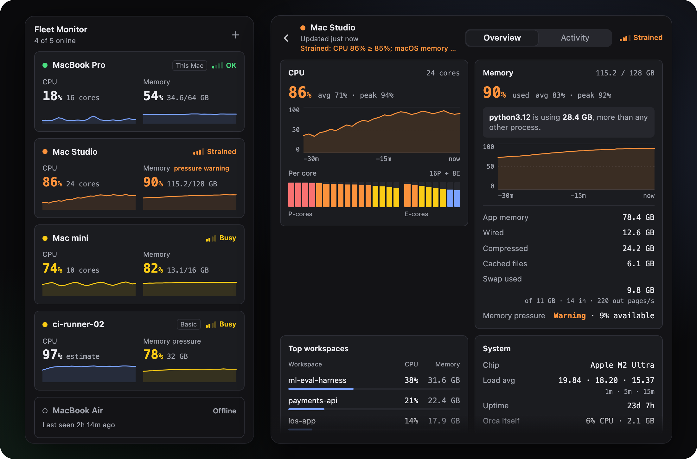
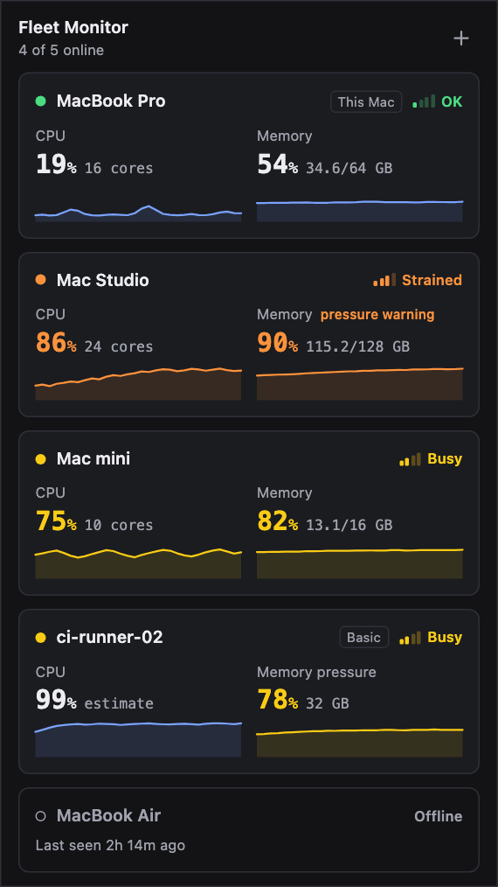
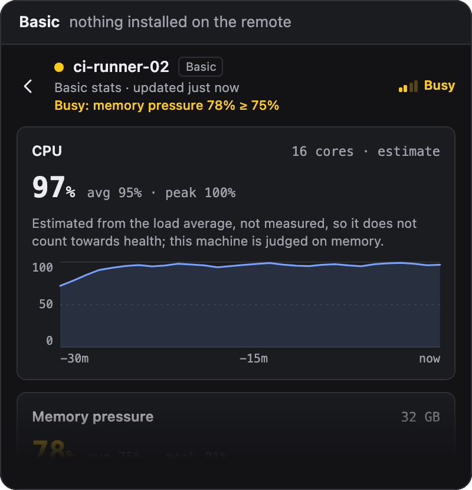
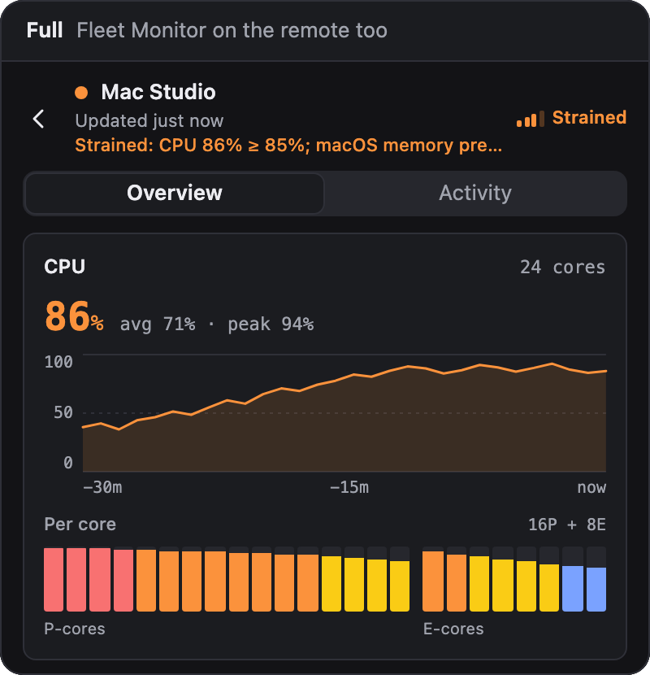
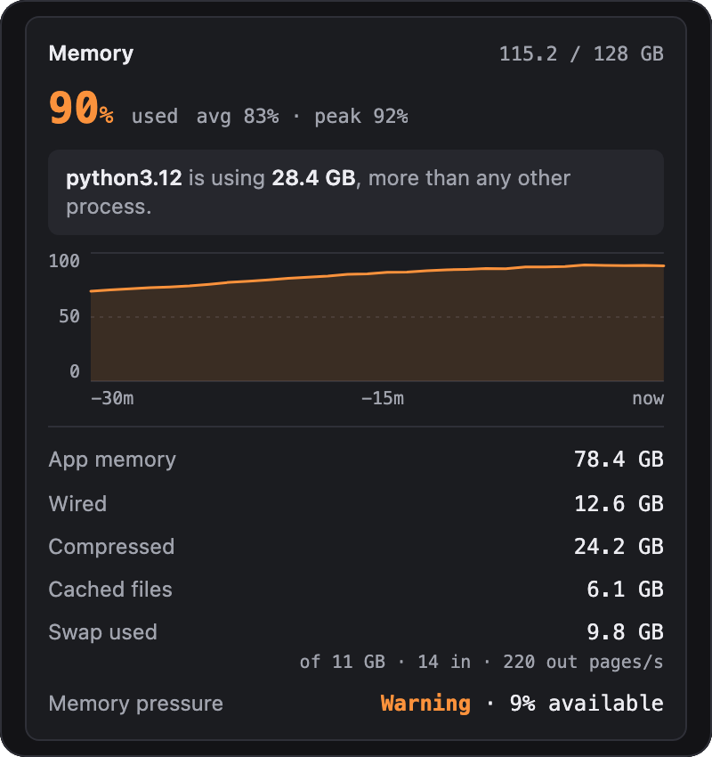
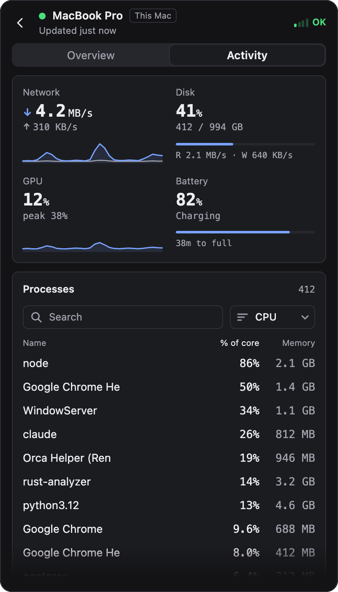
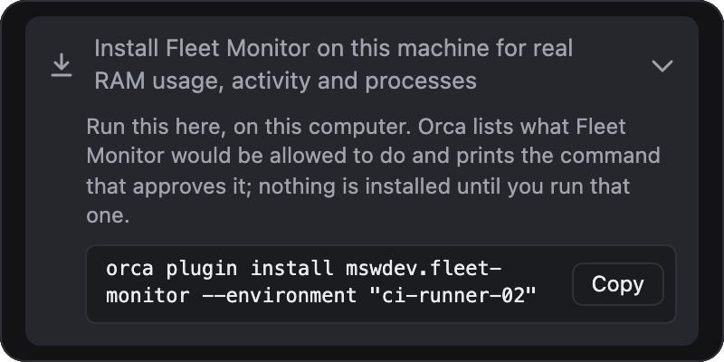

<div align="center">


<h1>Fleet Monitor</h1>

<p>
<b>A system monitor for every machine your Orca reaches.</b><br>
Live CPU, memory, per-core load and the busiest workspaces for this computer and every paired Orca server, in one sidebar panel. It runs over Orca's own pairing, with no SSH.
</p>

<p>
<a href="https://github.com/mswdev/orca-fleet-monitor/releases/latest"></a>
<a href="https://github.com/mswdev/orca-fleet-monitor/actions/workflows/ci.yml?query=branch%3Amain"></a>
<a href="https://github.com/mswdev/orca-fleet-monitor/actions/workflows/ci.yml?query=branch%3Amain"></a>


<a href="LICENSE"></a>
</p>

<p>
<a href="#install">Install</a> ·
<a href="#what-it-shows">What it shows</a> ·
<a href="#two-levels-of-detail">Basic and full</a> ·
<a href="#memory">Memory</a> ·
<a href="#memory-alerts">Alerts</a> ·
<a href="#settings">Settings</a> ·
<a href="#in-the-background">Background and privacy</a> ·
<a href="#requirements-and-limits">Limits</a>
</p>

<picture>
  <source media="(prefers-color-scheme: dark)" srcset="media/readme/hero-dark.svg">
  <source media="(prefers-color-scheme: light)" srcset="media/readme/hero-light.svg">
  
</picture>

<p><sub>The overview, and one machine's detail, redrawn from the real panel and animated. Every image on this page shows invented sample data.</sub></p>

</div>

Fleet Monitor is a plugin for [Orca](https://github.com/stablyai/orca). It puts live performance stats for all your machines in Orca's right sidebar: CPU and RAM for this computer and for every remote machine you have paired, with 30 minutes of history. If you would otherwise open an activity monitor or task manager on each machine to find out which one is busy, this shows them side by side.

A paired server shows up without anything installed on it. Install Fleet Monitor there as well and you get measured CPU, the load on every core and, on a Mac, real RAM usage, network, disk, GPU and battery readings, and its busiest processes.

To install it on this computer, [open it in Orca](https://orca.dev/plugins/mswdev.fleet-monitor?catalog=community) or run:

```sh
orca plugin install mswdev.fleet-monitor
```

[Install](#install) has the command for a paired server.

> [!NOTE]
> Fleet Monitor is tested on macOS only, and in practice macOS is the only platform it supports. Linux and Windows are implemented but untested. It needs the Orca desktop app, version 1.4.248 or later.

## What it shows

<picture>
  <source media="(prefers-color-scheme: dark)" srcset="media/readme/demo-dark.gif">
  <source media="(prefers-color-scheme: light)" srcset="media/readme/demo-light.gif">
  
</picture>

The panel opens on an overview with one card per machine. Click a card for that machine's detail.

- Each card has the machine's health, its CPU and memory, and a 30-minute sparkline of each.
- The detail has CPU and memory charts with the average and peak, the load on every core (P-cores and E-cores apart on Apple silicon), the five busiest workspaces, load averages, uptime, the chip, and what Orca itself is using.
- On a Mac running Fleet Monitor, memory is real RAM usage with its breakdown, swap and the kernel's pressure level. [Memory](#memory) has the details.
- On a Mac running Fleet Monitor, the detail has two tabs. **Overview** is everything above. **Activity** has network, disk, GPU and battery readings and the machine's processes, to search and sort. [Activity](#activity) has the details.
- While a machine's memory is strained or critical, its Memory card names the process using the most memory and how much it uses, when that is at least 5% of the machine's RAM. A machine short of memory can pause reading its processes; the card then gives the last figure it has, for up to 15 minutes, and says how old it is.
- Health has four levels: OK, busy, strained and critical. It is the worse of the CPU level and the memory level, and the detail says why, for example "Strained: CPU 86% ≥ 85%".
- A desktop notification tells you when a machine's memory reaches Strained or Critical, and when a machine stops answering while its memory is short. [Memory alerts](#memory-alerts) has the details.
- Each level is drawn as one to four bars as well as a colour, so you can read it without the colour.
- A machine that goes offline keeps its last readings and says when it was last seen.
- A status bar item names the machine that most needs attention, such as `Mac Studio strained · 1 offline`, and lists every machine in its tooltip. Clicking it opens the panel.
- Colours follow your Orca theme, light or dark.

To add a machine, pair it in Orca under **Settings → Remote Orca servers → Add server**. The panel's **+** button shows the same hint.

<sub>The clip runs at five times real speed. In Orca a reading arrives every 5 seconds.</sub>

<br clear="right">

## Two levels of detail

A paired server appears at the basic level as soon as Orca reaches it. Install Fleet Monitor on that server too and it moves to the full level. This computer is always full.

<p align="center">
  <picture>
    <source media="(prefers-color-scheme: dark)" srcset="media/readme/level-basic-dark.png">
    <source media="(prefers-color-scheme: light)" srcset="media/readme/level-basic-light.png">
    
  </picture>
  <picture>
    <source media="(prefers-color-scheme: dark)" srcset="media/readme/level-full-dark.png">
    <source media="(prefers-color-scheme: light)" srcset="media/readme/level-full-light.png">
    
  </picture>
</p>

| | Basic | Full |
| --- | --- | --- |
| Needs on the remote | Nothing | Fleet Monitor installed and running |
| CPU | An estimate from the load average, labelled as one | Measured |
| Per-core load, P-cores and E-cores | No | Yes |
| Memory | Orca's memory-pressure percentage, labelled "memory pressure" | On a Mac, RAM used and its breakdown, swap and the kernel's pressure level |
| Network, disk, GPU and battery | No | On a Mac |
| Processes | No | On a Mac: every process on this computer, the busiest 60 or so on a paired server |
| Busiest workspaces | Yes | Yes |
| Orca's own CPU and memory | Yes | Yes |
| Load average | 1 minute | 1, 5 and 15 minutes |
| Uptime and chip | No | Yes |

The basic CPU figure is the 1-minute load average divided by the number of cores. Load also counts threads waiting to run and, on Linux, threads waiting for disk, so the estimate can be far from real CPU use. The panel labels it as an estimate wherever it appears and does not colour it by the CPU thresholds. It never sets a machine's health or the status bar. Windows has no load average, so a basic Windows server shows no estimate and the panel says so.

How each level is read:

- Basic comes from the Orca CLI, `orca diagnostics memory --environment <server>`.
- Full adds a short reading that the remote's copy of Fleet Monitor writes to its own plugin log every 5 seconds. This computer reads it back with `orca plugin logs`. [What a machine publishes](#what-a-machine-publishes) lists what is in it.

While a panel is open, Fleet Monitor checks basic machines about every 30 seconds for a newly installed copy, so a machine moves to full shortly after you install it there. If a full machine's readings stop arriving, it goes back to basic, within about 20 seconds while a panel is open, and returns to full when they start again.

If a machine stays at basic after you install Fleet Monitor on it, its detail screen says why. Either the plugin is installed there but not running, or it is running and its readings are not arriving, which usually means **Publish this machine's readings** is off on that machine.

## Memory

<picture>
  <source media="(prefers-color-scheme: dark)" srcset="media/readme/memory-dark.png">
  <source media="(prefers-color-scheme: light)" srcset="media/readme/memory-light.png">
  
</picture>

What a machine reports about memory depends on its level.

A Mac running Fleet Monitor reports real RAM usage. The figure is computed the way Activity Monitor computes Memory Used. In a five-minute side-by-side check on a 64 GB Mac, the two differed by 0.1 GB on average, and swap used matched exactly. With it come app memory, wired memory, compressed memory, cached files, swap used, and the kernel's memory pressure level, which is normal, warning or critical.

A machine without Fleet Monitor reports only Orca's memory-pressure percentage. The panel labels that figure "memory pressure", because it does not measure memory used.

The memory level is there to warn you before a machine locks up. Kernel pressure at warning makes a machine Strained, and at critical makes it Critical. RAM used above a threshold you can change, 90% by default, makes it Busy. Memory pressure has its own thresholds (75, 88 and 95% by default), and sustained swapping counts as well.

If one of a Mac's two memory commands fails, Fleet Monitor keeps what the other returned. If both fail, it carries the last reading over the next two, marked with its age, and after that the reading is unknown. The panel says when figures are carried. When Orca reports only free memory for a Mac, which Orca can do for the rest of its run after one slow reading, the panel says memory is unavailable and nothing is judged on it.

<br clear="right">

## Activity

<picture>
  <source media="(prefers-color-scheme: dark)" srcset="media/readme/activity-dark.png">
  <source media="(prefers-color-scheme: light)" srcset="media/readme/activity-light.png">
  
</picture>

A Mac running Fleet Monitor 1.2 or later, and this computer when it is a Mac, has a second tab in its detail, **Activity**. Opening a machine always lands on **Overview**, the view described above.

The top of the tab has a reading for each of these that the machine reports. One it does not report, such as the battery of a desktop Mac, is left out.

- Network: what the main network interface receives and sends, with the last 30 minutes of both.
- Disk: the space used on the startup disk, and what all disks read and write.
- GPU: how busy the GPU is, with its peak in the last 30 minutes.
- Battery: the charge, whether it is charging, and the time to full or to empty when macOS has an estimate.

Network is read every 5 seconds, disk traffic every 20, the GPU every 30, and the battery and disk space every 60.

Below them is the machine's list of processes. It shows the first 25, and **Show all** shows the rest. You can search by name or process ID, and sort by CPU, memory, energy impact or name. A row opens to show its process ID, its owner and how long it has been running. The list keeps its order while a row is open or the keyboard is in it, so rows do not move under you.

- Names are the system's short process names, at most 16 characters, so a name can be cut short: Google Chrome Helper shows as `Google Chrome He`. They are not always the names Activity Monitor shows, and no command line or path is ever shown or published.
- CPU is a share of one core, as Activity Monitor shows it, so a process busy on four cores shows 400%.
- Memory is the footprint Activity Monitor shows in its Memory column. A process started in the last two minutes may not have a figure yet, and shows a dash.
- Energy impact is the figure `top` reports.

For this computer, the list has every process, up to what one answer to the panel holds; past that it has the busiest, and says so. A paired Mac sends only its busiest, about 60 by memory and CPU, and a new list about every 30 seconds. The panel says so under the list, with how old it is. A machine on a Fleet Monitor older than 1.2 has no Activity tab, and its detail says to update it.

The list is asked for only while a machine's Activity tab is on screen and the panel is visible.

<br clear="right">

## Memory alerts

Fleet Monitor sends a desktop notification when a machine's memory runs short:

- at Critical, on the first reading that shows it;
- at Strained, once two readings in a row show it, which on a Mac running Fleet Monitor is about 10 seconds;
- again if it goes on from Strained to Critical, and as a reminder every 10 minutes while it stays Critical, up to five an hour;
- when a machine stops answering, or its readings stop arriving, while its memory was elevated (see below). The notification gives the last reading, for example "Mac mini stopped answering. Last reading, 20 s ago: memory pressure critical, 15.8 of 16 GB used, swap 9.1 GB." The panel, the status bar and its tooltip say the same until the machine's readings come back.

A machine counts as stopped only once a call to it fails, or a fresh read of its log still finds nothing new; not reading it (no panel open with background monitoring off) never counts. Just after this computer wakes from sleep, Fleet Monitor waits a minute before it decides.

Alerts are judged on the machine's own readings, not on how often this computer reads it. A Mac running Fleet Monitor writes a reading every 5 seconds, and each read of its log brings every reading written since the last one, so each counts. For a machine without Fleet Monitor, or with a version before 1.1, each answer from Orca is a reading.

A reading that could not be taken, or one carried over a failed read, is unknown: it neither counts towards an alert nor cancels one that is building. On a Mac that reports its own readings, Orca's figure counts only when it is Strained or Critical, because Orca does not see the kernel's pressure level.

Memory is elevated at any of: kernel pressure above normal, RAM used at 80% or more, 30% or less of memory available, or any swap-outs since the last reading. While a machine's memory is elevated and no panel is open, Fleet Monitor reads it about every 15 seconds instead of every 60, and retries it from 15 seconds when it does not answer. That is about three more CLI calls a minute for that machine, until its memory is back to normal.

How long an alert takes, from the remote Mac's own reading to the notification, in a simulation with every timing at its worst:

- with a panel open, up to about 10 seconds for Critical and 15 for Strained;
- with no panel open and memory already elevated, up to about 20 seconds for Critical and 25 for Strained;
- with no panel open and memory fine until then, up to about a minute, the slow interval.

After two minutes back below Strained, the next time a machine gets there alerts again. A machine gets at most six notifications an hour, and at most three of them for Strained, so a machine that keeps flipping cannot flood you and there is always room for Critical and for "stopped answering".

To check that this computer shows them, run **Fleet Monitor: Send a test alert** from Orca's command palette. Orca reports a notification as delivered once it has handed it to macOS, but Focus, or Orca's notification setting in System Settings, can still keep it off the screen. Only the test shows you. Each notification also writes one line to the plugin's log with what Orca answered.

> [!IMPORTANT]
> With **Monitor in the background** off, paired machines are read, and alert, only while a Fleet Monitor panel is open on this computer. This computer still alerts about itself.

What it cannot catch: a machine that goes from fine to locked up between two reads. With no panel open, a machine whose memory is not elevated is read once a minute. If it runs out of memory and stops answering within that minute, there is no reading of the problem to send, and it shows as offline like any other machine. A Mac on its way to running out usually passes through elevated first, and from then on it is read every 15 seconds and its silence is reported.

## Install

On this computer:

```sh
orca plugin install mswdev.fleet-monitor
```

You can also install it from **Settings → Plugins** in Orca, or with the [Open in Orca](https://orca.dev/plugins/mswdev.fleet-monitor?catalog=community) link.

For the full level on a paired server, run the same command on this computer with that server's name, as `orca environment list` shows it:

```sh
orca plugin install mswdev.fleet-monitor --environment "<server name>"
```

Orca asks before it installs anything that runs code. The first `install` stops with `approval_required`, lists what the plugin would be allowed to do, and prints the exact command, ending in `--approve <fingerprint>`, that installs it. Fleet Monitor never installs anything by itself.

<picture>
  <source media="(prefers-color-scheme: dark)" srcset="media/readme/install-dark.png">
  <source media="(prefers-color-scheme: light)" srcset="media/readme/install-light.png">
  
</picture>

A basic machine's detail screen gives you the second command already filled in, with a Copy button. If a server's name is not plain text, or another server answers to the same name, the panel uses the server's id instead (`--environment=<id>`).

On a Linux desktop, type `orca-ide` where these commands say `orca`.

<br clear="right">

## Settings

| Setting | Default | What it does |
| --- | --- | --- |
| Fast interval | 5 s | How often machines are read while a Fleet Monitor panel is open. 2 to 60 seconds. |
| Slow interval | 60 s | How often they are read for the status bar while no panel is open. 15 seconds to 1 hour. |
| CPU busy, strained, critical at | 70,&nbsp;85,&nbsp;95&nbsp;% | The thresholds for the CPU level. |
| Memory busy, strained, critical at | 75,&nbsp;88,&nbsp;95&nbsp;% | The thresholds for memory pressure, the share of memory the system no longer has available. |
| RAM used busy at | 90&nbsp;% | A machine whose RAM used passes this counts as Busy. [Memory](#memory) has the other memory rules. |
| Alert when memory runs short | On | Sends a desktop notification when a machine's memory reaches Strained or Critical, or when it stops answering while its memory is short. [Memory alerts](#memory-alerts) has the details. |
| Orca CLI path | Empty | Leave it empty to find the CLI that ships with this Orca. |
| Publish this machine's readings | On | Writes a short reading to this plugin's log every 5 seconds, so a paired desktop can show this machine at the full level. On a Mac it also writes the names and owners of its top processes about every 30 seconds. |
| Monitor in the background | On | Reads machines on the slow interval while no panel is open, to keep the status bar current and to send memory alerts for paired machines. Off, paired machines alert only while a panel is open. |

## In the background

Each installed copy runs a worker for as long as the plugin is enabled. With no panel open, the worker does two things:

- It publishes this machine's readings every 5 seconds and, on a Mac, its top processes every 30. **Publish this machine's readings** turns that off.
- It reads every machine its Orca reaches every 60 seconds, the slow interval, to keep its status bar item current and to send memory alerts. **Monitor in the background** turns that off.

On a server that has Fleet Monitor only so that a desktop can show it at the full level, nobody looks at the status bar. Turn **Monitor in the background** off there. The server then makes no CLI calls unless one of its own panels is open, and it keeps publishing. The setting is on by default everywhere because Orca gives a plugin no reliable way to tell such a server from a desktop. On a desktop with it off, the status bar sums up this computer only, and paired machines send no alerts while no panel is open.

### What polling costs

Reading a machine means running the Orca CLI, one short-lived process per read. Each takes a few tenths of a second, most of it start-up.

- Fleet Monitor reads machines every 5 seconds only while a panel is open. Otherwise it reads them every 60 seconds, or not at all with background monitoring off. A machine whose memory is elevated is read about every 15 seconds until it recovers ([Memory alerts](#memory-alerts)).
- While a panel is open, the diagnostics call for a full machine, and for this computer, runs every 15 seconds instead of every 5.
- At most two reads run at once. A machine that fails to answer moves to two slots of its own, so it can hold up the others for one call at most, until the 15-second timeout.
- Fleet Monitor retries an unreachable machine with a growing delay, up to 5 minutes.
- While a machine's Activity tab is on screen, the panel asks for its processes every 5 seconds for this computer and every 10 seconds for a paired Mac. This computer reads its processes only while asked.

Measured on a Mac, the worker uses about 1% of one core with nobody looking. While this computer's Activity tab is open, it uses about 8% of one core to read its processes, and stops 20 seconds after the tab closes.

### What a machine publishes

With **Publish this machine's readings** on, which is the default, the worker writes one line to its own plugin log every 5 seconds. The line starts `FLEETMON1` and holds:

- the hostname, platform, architecture, OS release and CPU model;
- the number of cores, the uptime, total and per-core CPU use, and on Apple silicon which cores are performance cores and which are efficiency cores;
- the load averages, and the memory figures listed under [Memory](#memory);
- on a Mac, the network, disk, GPU and battery readings listed under [Activity](#activity);
- a random id for the worker run, a sequence number and the time.

On a Mac, about every 30 seconds, it also writes a line starting `FLEETPS1` with its top processes, about 60 by memory and CPU. For each one it holds the process ID, the parent's process ID, the short name (at most 16 characters, with no arguments or path), the owner's user name, CPU, memory, energy impact and the start time.

The same log gets one line for each memory alert the machine shows, with the alert's title, which names the machine the alert is about, and whether Orca delivered it.

Anyone who can read that machine's plugin logs can read these lines. That means someone on that machine, and any Orca paired with it (`orca plugin logs <key> --environment <machine>`). Nothing is sent anywhere else, and the panel makes no network requests. With the setting off, other machines show this one at the basic level.

<details>
<summary>What the plugin is allowed to do</summary>

Fleet Monitor is a full-access (`trusted-worker`) plugin: its worker runs as a Node process on your machine.

- It asks for two capabilities: `settings:own`, and `notifications:show` for the memory notifications. It adds one panel, one status bar item and two commands, **Show Fleet Monitor** and **Fleet Monitor: Send a test alert**.
- In the desktop app, the panel's **Star on GitHub** link opens this project's page, `https://github.com/mswdev/orca-fleet-monitor`, in your browser through Orca, which asks you first. It is the only address the plugin opens, and only when you click it.
- It runs these Orca CLI commands, all read-only: `environment list`, `host list`, `diagnostics memory`, `plugin list` and `plugin logs`. The last three also run against paired servers.
- It runs `plugin open` on this machine when you click the status bar item.
- On macOS it runs `vm_stat` and `sysctl` with each 5-second reading, to measure memory, swap and memory pressure, and `sysctl -n hw.perflevel0.logicalcpu hw.perflevel1.logicalcpu` once, to learn which cores are which. It also runs `ps` and `top` for the process list, `netstat` and `route` for the network, `ioreg` for disk traffic and the GPU, and `pmset` for the battery. On Windows it runs `taskkill` to end a CLI call that timed out.

</details>

<details>
<summary>How it treats data from other machines</summary>

Fleet Monitor treats a paired server, the CLI's answers about it and the lines in its log as untrusted. A broken or hostile server must not break the panel for the others.

- It cuts every name, error message and list from another machine to a fixed length and count as it arrives. Plugin keys and environment ids must look like one before they go into a CLI argument.
- It replaces Unicode bidirectional controls in that text with U+FFFD, so they cannot reorder what the panel or status bar draws.
- It bounds the values in a published reading too: cores, uptime, memory and the interval.
- Only plain data reaches the panel, and it always fits Orca's size limits. History is thinned first, then detail is dropped, then machines are left out and counted.
- The panel puts remote text into the page as text, never as markup.

</details>

## Requirements and limits

- Orca 1.4.248 or later.
- The Orca desktop app. The panel is not made for Orca's browser client (`orca serve` opened in a web browser).
- macOS, both for this computer and for paired servers. It is the only platform Fleet Monitor is tested on and, in practice, the only one it supports. Linux and Windows are implemented but untested. That covers the launcher names, ending a timed-out CLI call's process tree, and Windows having no load average.
- History covers the last 30 minutes. The worker keeps it in memory, so it starts again whenever Orca or the plugin restarts. So does what it has already alerted about: after a restart, a machine that is still short of memory alerts again.
- When a machine reaches the full level, the readings still in its log, about the last 16 minutes, fill the gaps in its history. They are added only where there is no reading yet.
- The Activity tab (network, disk, GPU, battery and processes) is a Mac's only: this computer when it is a Mac, and paired Macs running Fleet Monitor 1.2 or later.
- Only Apple silicon reports the split into P-cores and E-cores. Which core is which was measured on an Apple M2 Max, and other Apple chips are assumed to number their cores the same way. Where the split is unknown, the panel draws the cores as one group.

## Development

```sh
orca plugin validate .
orca plugin test .       # unit tests, synthetic data only
npm install              # dev dependencies, for type-checking only
npm run typecheck        # orca plugin types ., then TypeScript with --noEmit
```

There are no runtime dependencies and no build step. Orca runs the TypeScript as it is. Type-checking needs Orca's typings, which `orca plugin types .` writes to `.orca/types/`, and Node's, which `npm install` adds to `node_modules/`. Orca ignores that folder.

`.npmrc` turns off npm's `node_modules/.bin` links, because Orca refuses symlinks anywhere in a plugin folder. Run TypeScript with `npm run typecheck` and leave `npx tsc` alone.

### Previewing the panel

`tools/preview/` runs the real panel against a stand-in for Orca, fed with invented sample data (`tools/preview/sample-fleet.mjs`, and `tools/preview/activity-sample.mjs` for what 1.2 adds). It covers every state in light and dark and with three invented host themes, at 220, 360 and 700 px; `tools/preview/activity.html` has each state of the Activity tab. No real machine names appear, so its images are safe to publish.

```sh
npm run preview                       # then open http://127.0.0.1:4173/tools/preview/
node tools/shoot-preview.mjs          # the listing images in media/
node tools/preview/shoot-readme.mjs   # the images on this page, in media/readme/
node tools/preview/shoot-activity.mjs --playwright <path to playwright-core>   # each Activity state, to compare with a design
```

Both capture scripts use a locally installed Chrome, Chromium or Edge (`--chrome <path>` to choose one) and download nothing. The README script needs Node 22 or later, and `ffmpeg` on the PATH for the animation. Run it again whenever the panel's look or the sample data changes.

### Reading the real fleet once

`tools/poll-once.ts` reads every machine once through the real CLI, outside Orca, and prints a summary with names replaced by placeholders:

```sh
env -i PATH=/usr/bin:/bin HOME="$HOME" TMPDIR="$TMPDIR" ELECTRON_RUN_AS_NODE=1 \
  /Applications/Orca.app/Contents/MacOS/Orca tools/poll-once.ts
```

### Layout

- `src/` is the worker: sampler, beacon, poller, merge, health, history, bridge, bounds, settings and status bar. It schedules on its own steady clock (`steadyClock` in `src/worker.ts`), which a wall clock set back does not move.
- `panel/` is plain HTML, CSS and JavaScript modules. `fleet-binding.mjs` keeps the fleet current and turns it into the panel's model, `view.mjs` draws that model, `activity.mjs` draws the Activity tab and the memory line from its own view-model, and `style.css` holds the design.
- `test/` has unit tests for both, run by `orca plugin test`. The panel's drawing is tested in a small fake DOM (`test/fake-dom.ts`) that refuses to parse any string as markup.
- `media/` has the icon, cover and screenshots the manifest lists, and `media/readme/` the images on this page.

<details>
<summary>Notes on core order and theme colours</summary>

Node does not say which `os.cpus()` entry is which kind of core. On an Apple M2 Max (8 performance, 4 efficiency) under macOS 26, background-priority busy loops, which macOS keeps on efficiency cores, drove entries 0 to 3 to 100%, and eight normal-priority loops drove entries 4 to 11. So the efficiency cores come first.

Orca hands panel frames the user's theme as `--orca-*` variables and a `light` or `dark` class. The panel never sets those variables, so the theme always wins, and the design's colours are only fallbacks. The four health colours are the plugin's own, with light and dark variants. The panel measures them against the theme's card and background and switches to a stronger set when a tinted theme would leave them below 4.5:1.

</details>

## Licence

[MIT](LICENSE)
