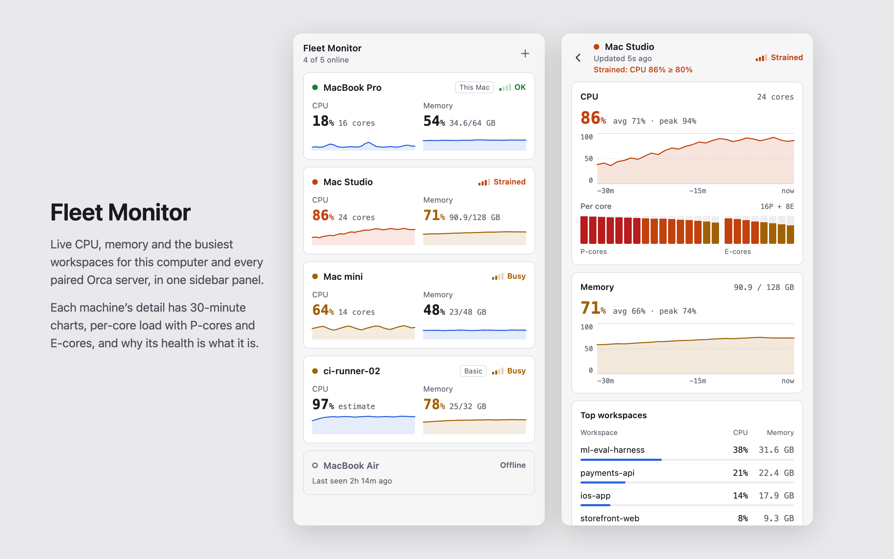

# orca-fleet-monitor

Orca plugin that shows the live performance of every machine your Orca reaches (this computer and each paired Orca server) in one sidebar panel: CPU, memory, per-core load and the busiest workspaces, with a 30-minute history. It works over Orca's own pairing, with no SSH, and needs nothing installed on the other machines for the basic view.



## Platforms and requirements

- **Tested on macOS only**: this computer and paired servers running macOS.
- **Linux and Windows are implemented but untested.** That covers the launcher names (Linux desktops use `orca-ide`), ending a timed-out CLI call's whole process tree (`taskkill` on Windows) and Windows having no load average.
- **The panel needs the Orca desktop app.** It is not made for Orca's browser client (`orca serve` opened in a web browser).
- Orca 1.4.248 or newer.

## What you get

- A **Fleet Monitor** panel in the right sidebar. The overview has one card per machine with its health, CPU and memory and a 30-minute sparkline of each. Click a card for that machine's detail: 30-minute CPU and memory charts with average and peak, per-core load (split into P-cores and E-cores on Apple silicon), the busiest workspaces, load averages, uptime, the chip, Orca's own usage, and why its health is what it is (for example "Strained: memory 90% ≥ 88%").
- A status bar item naming the machine that most needs attention (`ok`, `busy`, `strained`, `critical`, plus how many are offline), with every machine in its tooltip. Clicking it opens the panel.
- Settings for the fast and slow polling intervals, separate CPU and memory thresholds, the Orca CLI path, whether this machine publishes its readings, and whether it monitors in the background (see [Running on a server](#running-on-a-server)).

A machine's health is the worse of its CPU level and its memory level, each judged on its own thresholds, from **measured** figures only. Colours follow your Orca theme; health is also shown as one to four bars, so it never relies on colour alone.

## Two tiers

- **Basic**: any paired Orca server, with nothing installed there. Fleet Monitor reads it through the Orca CLI (`orca diagnostics memory --environment <server>`): memory as Orca measures it, the 1-minute load average, Orca's own CPU and memory, and the busiest workspaces.
  - There is no CPU reading at this tier. The panel shows an **estimate** (the load average divided by the number of cores) and labels it as one wherever it appears.
  - Load is not CPU use (it counts threads waiting to run and, on Linux, threads waiting for disk), so the estimate can be far off. It **never sets the machine's health or the status bar**, and is not coloured by the CPU thresholds: a basic machine is judged on its memory alone.
  - Windows has no load average (Orca reports 0 there), so on a Windows server there is no estimate, and the panel says so rather than showing 0%.
- **Full**: the other machine also runs Fleet Monitor. Its worker publishes a short reading every 5 seconds in its own plugin log (see [What a machine publishes](#what-a-machine-publishes)), which this computer reads back with `orca plugin logs`.
  - That adds measured CPU, per-core CPU (with the P-core/E-core split on Apple silicon), 5- and 15-minute load, uptime and the chip.
  - When a machine reaches the full tier, the readings still in its log (about the last 16 minutes) fill the gaps in its history. They are only added where there is no reading yet; none taken before is replaced.
  - A Mac's own readings carry no trustworthy memory figure (macOS counts reclaimable cache as used), so **memory history is not back-filled for Mac servers**. Their memory chart starts when Fleet Monitor first reads them.
  - If a machine's readings stop arriving (its log cannot be read, or its worker stopped), it goes back to the basic tier within about 20 seconds, and its diagnostics drive its readings and history again.

This computer is always read directly (Node's `os` module plus Orca's diagnostics), so it is always full.

While a panel is open, a basic machine is checked about every 30 seconds for a newly installed Fleet Monitor (and once as the panel opens), so it moves to the full tier shortly after you install it there.

## Install

On this computer:

```sh
orca plugin install mswdev/orca-fleet-monitor
```

(On a Linux desktop the command is `orca-ide` rather than `orca`.)

On a paired Orca server, for the full tier, run this **on this computer** with that server's name as Orca lists it (`orca environment list`):

```sh
orca plugin install mswdev/orca-fleet-monitor --environment "Build Box"
```

A basic machine's detail screen offers this command, filled in, with a Copy button. Because the server's name comes from that server, the command uses it only when it is plain text: ASCII letters, digits, spaces, `.`, `_`, `-` and `'`, not starting with `-`, and not shared with another paired server. Otherwise it uses the server's id instead (`--environment=<id>`), and if even that is not plain, it offers no command, only directions.

Fleet Monitor never installs anything by itself. Because it runs code, the first `install` stops with `approval_required`, lists what the plugin would be allowed to do, and prints the exact command (with `--approve <fingerprint>`) that installs it.

## Running on a server

Every copy of Fleet Monitor runs its worker for as long as the plugin is enabled, because it has a status bar item. In the background, with no panel open, it:

- publishes its readings every 5 seconds (unless **Publish this machine's readings** is off), and
- reads every machine its Orca reaches every 60 seconds (the slow interval), to keep its status bar current.

On a server that has Fleet Monitor only so that a desktop can show it at the full tier, nobody looks at that status bar. Turn off **Monitor in the background** there. It then makes no CLI calls at all while no Fleet Monitor panel is open on that server, keeps publishing its readings, and reads machines only while one of its own panels is open.

The setting is on by default everywhere. Orca gives a plugin no reliable way to tell a server nobody looks at from a desktop: the status bar works in both, and `orca status` cannot tell `orca serve` from a desktop whose window is closed. So Fleet Monitor does not guess. On a desktop with it off, the status bar sums up this computer only.

## What a machine publishes

When **Publish this machine's readings** is on (the default), the worker writes one line to its own plugin log every 5 seconds, starting `FLEETMON1`. It contains:

- the hostname, platform, architecture and OS release, and the CPU model;
- the number of cores, the uptime, total and per-core CPU busy (%), and on Apple silicon which cores are performance and which efficiency cores;
- total and free memory as Node reports them, and the 1-, 5- and 15-minute load averages;
- a random id for the worker run, a sequence number, and the time.

Anyone who can read that machine's plugin logs can read these lines: someone on that machine, and any Orca paired with it (`orca plugin logs <key> --environment <machine>`). Nothing else is sent anywhere. Turn the setting off on a machine to stop it publishing; other machines then show it at the basic tier.

## What it trusts

A paired server, the CLI answers about it and its log lines are treated as untrusted: a broken or hostile server must not break the panel for the others.

- Every name, error message and list from another machine is cut to a fixed length and count as it comes in. Plugin keys and environment ids must look like one before they go into a CLI argument.
- Beacon values are bounded too (cores, uptime, memory, the beacon interval).
- Only plain data reaches the panel, and the panel's snapshot always fits Orca's 1 MiB limit: history is thinned first, then detail is dropped, then machines are left out (and counted).
- The panel puts remote text into the page only as text, never as markup.

## Cost and access

Each CLI call starts a short-lived process (about 0.3 s, mostly start-up). Machines are polled quickly (every 5 s by default) only while a Fleet Monitor panel is open, and slowly (every 60 s, or not at all with background monitoring off) otherwise. On the full tier, memory and workspaces are read every 15 s rather than every 5 s.

At most two CLI calls run at once for this computer and the machines that answer. Machines that are connecting, offline or failing get two slots of their own, so one that hangs until the 15-second timeout never delays the others. An unreachable machine is retried with growing back-off, and so are a plugin list or a plugin log that cannot be read.

It is a full-access (`trusted-worker`) plugin: its worker runs as a Node process on your machine.

- It runs these Orca CLI commands, all read-only: `environment list`, `host list` (for the name Orca shows for this computer), `diagnostics memory`, `plugin list` and `plugin logs`. The last three also run against paired servers.
- It also runs `plugin open` on this machine when you click the status bar item.
- On macOS it runs `sysctl -n hw.perflevel0.logicalcpu hw.perflevel1.logicalcpu` once, to learn the core split. On Windows it runs `taskkill` to end a CLI call that timed out.
- It asks for one capability, `settings:own`, and adds one panel, one status bar item and one command (**Show Fleet Monitor**, which the status bar item runs).
- The panel makes no network requests.

## Development

```sh
orca plugin validate .
orca plugin test .            # unit tests; synthetic data only
```

### Type-checking

The plugin has no runtime dependencies and no build step; Orca runs the TypeScript itself. Type-checking needs two things that are not in the repository: Orca's typings (`orca plugin types .` writes them to `.orca/types/`) and Node's (`npm install` installs `typescript` and `@types/node`, as dev dependencies only, into `node_modules/`, which Orca ignores). Then:

```sh
npm install
npm run typecheck             # orca plugin types ., then TypeScript with --noEmit
```

`.npmrc` turns off npm's `node_modules/.bin` links, because Orca refuses symlinks anywhere in a plugin folder (`orca plugin inspect .` and folder installs would fail). Run TypeScript through `npm run typecheck` rather than `npx tsc`. Development loading ignores `node_modules/` either way.

### Previewing the panel with sample data

`tools/preview/` runs the real panel code against a stand-in for Orca, fed with invented sample data (`tools/preview/sample-fleet.mjs`, after the design's own sample): every state (overview, detail, basic, offline, loading, nothing paired, a machine connecting, an unreachable worker), in light and dark and with three invented host themes, at 220, 360 and 700 px. No real machine names appear, so its images are safe for listings.

```sh
node tools/preview-server.mjs           # then open http://127.0.0.1:4173/tools/preview/
node tools/shoot-preview.mjs            # the listing images in media/: icon, cover, three screenshots
```

`shoot-preview.mjs` uses a locally installed Chrome, Chromium or Edge (`--chrome <path>` to choose one) and downloads nothing.

### Reading the real fleet once

`tools/poll-once.ts` reads every machine once through the real CLI, outside Orca, and prints a summary with names replaced by placeholders:

```sh
env -i PATH=/usr/bin:/bin HOME="$HOME" TMPDIR="$TMPDIR" ELECTRON_RUN_AS_NODE=1 \
  /Applications/Orca.app/Contents/MacOS/Orca tools/poll-once.ts
```

### Layout

- `src/`: the worker (TypeScript that Orca loads without a build step): sampler, beacon, poller, merge, health, history, bridge, bounds, settings, status bar. The worker schedules on its own steady clock (`steadyClock` in `src/worker.ts`), which a wall clock set back does not move; the panel works out its offset from each answer.
- `panel/`: plain HTML, CSS and JavaScript modules. `fleet-binding.mjs` is the seam between the worker and the drawing: it keeps the fleet current and turns it into the panel's model (`toFleet`). `view.mjs` draws that model; `style.css` holds the design.
- `test/`: unit tests for both, run by `orca plugin test`. The panel's drawing is tested in a small fake DOM (`test/fake-dom.ts`) that refuses to parse any string as markup.
- `media/`: the icon, cover and screenshots the manifest lists, made by `tools/shoot-preview.mjs`.

### Notes

- **P-cores and E-cores.** Node does not say which `os.cpus()` entry is which kind of core. Measured on an Apple M2 Max (8 performance, 4 efficiency) under macOS 26: background-priority busy loops, which macOS keeps on efficiency cores, drove entries 0–3 to 100 %, and eight normal-priority loops drove entries 4–11. So the efficiency cores come first. Other Apple chips are assumed to number their cores the same way; that has not been measured. Anywhere the split is unknown, cores are shown as one group.
- **Theme.** Orca hands panel frames the user's theme as `--orca-*` variables and a `light` or `dark` class. The panel never sets those variables, so the theme always wins; the design's colours are only fallbacks. The four health colours are the plugin's own, with light and dark variants. The panel measures them against the theme's card and background and switches to a stronger set when a tinted theme would leave them below 4.5:1.

## License

MIT
